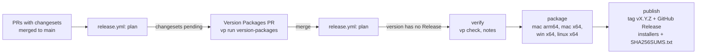

# Release process

`main` is the only long-lived branch. Releases follow [Semantic Versioning](https://semver.org) and are driven by [Changesets](https://github.com/changesets/changesets) and `.github/workflows/release.yml`.

## Versioned packages

- `@ppb/cli`, `@ppb/desktop`, `@ppb/web`, `@ppb/core`, `@ppb/shared`, `@ppb/mcp`, and `@ppb/server` are versioned in lockstep (`fixed` in `.changeset/config.json`). The desktop version is the app version Tauri stamps on the installers.
- `scripts/version-packages.ts` copies that version to the private root `package.json` and adds a `## [x.y.z] — date` section to the root `CHANGELOG.md`. That section becomes the GitHub Release notes.
- Nothing is published to npm; the release artifacts are the desktop installers and the `ppb` CLI bundled inside them.

## Day to day

1. Make the change on a branch and open a PR to `main` (CI: `vp check`, `vp run -r build`, Linux installers, a Windows installer build, and an advisory changeset check).
2. If people using `ppb` or the app will notice the change, add a changeset: `vp run changeset`, pick `@ppb/cli` or `@ppb/desktop`, choose the bump, and write one or two sentences for the release notes. Docs, CI, and internal refactors need none.

Bumps before 1.0: `patch` for fixes, `minor` for features and for changes that need users to act. After 1.0, `major` for breaking changes to saved data or behavior.

## Cutting a release



1. Every push to `main` runs `plan`. With pending changesets it opens or updates the **chore(release): version packages** PR: versions bumped, changesets consumed, CHANGELOGs written. Edit the root `CHANGELOG.md` section in that PR if the notes need polish.
2. Merging that PR is the release. `plan` sees a version whose CHANGELOG section exists and that has no GitHub Release, then:
   - `verify` checks lockstep versions, runs `vp check`, and extracts the notes;
   - `package` builds installers on GitHub-hosted runners: `.dmg` for macOS arm64 and x64, NSIS `.exe` for Windows x64, `.deb` for Linux x64 (names: `pp-browser-<version>-<os>-<arch>.<ext>`);
   - `publish` (environment `release`) creates tag `vX.Y.Z` and the GitHub Release with every installer and `SHA256SUMS.txt`. Versions with a pre-release suffix (`0.2.0-rc.1`) are marked as pre-releases.
3. A failed run is retried by re-running the failed jobs; an existing tag or Release is left alone.

Preview the version step locally (it rewrites files; discard them afterwards):

```bash
vp run version-packages
git restore . && git clean -fd .changeset
```

## Repository settings the workflow needs

- **Actions → General → Workflow permissions:** "Allow GitHub Actions to create and approve pull requests" (for the Version Packages PR).
- **Environments → `release`:** add required reviewers here for a manual gate before publishing.
- The `publish` job's `permissions: contents: write` creates the tag and Release with `GITHUB_TOKEN`, which works even though the repository's default workflow permission is read-only.
- Because the Version Packages PR is opened with `GITHUB_TOKEN`, CI does not run on it; `verify` re-checks the merged commit.

## Code signing

Signing is not configured yet. Builds are ad-hoc signed: macOS apps open via right-click → **Open** the first time (Gatekeeper warning), and the Windows installer is unsigned (SmartScreen warning). To add Developer ID signing and notarization later, add `CSC_LINK`/`CSC_KEY_PASSWORD` and the `APPLE_*` secrets and extend the `Make installers` step — see the Tauri code-signing guide. Forks and local builds need nothing.

## Not verified

Only the macOS arm64 build has been exercised end to end (locally). The Windows, macOS x64, and Linux installer paths follow the documented Tauri setup and run in CI, but the installed app has not been smoke-tested on each. Linux ships a `.deb` only: the AppImage target needs `linuxdeploy`, which fails to launch on GitHub's Ubuntu 24.04 runners (no FUSE kernel module). Revisit AppImage (and add `.rpm`) when FUSE is available on the runner, e.g. with `ubuntu-22.04` or a self-hosted runner.

## Updating workflow dependencies

Some Actions are pinned by commit SHA with the version in a comment (`checkout`, `setup-vp`, `upload-artifact`, `download-artifact`, `changesets/action`); the Rust toolchain and cache actions use tags (`@stable`, `@v2`). Dependabot can be added (`.github/dependabot.yml`) to propose updates weekly.
